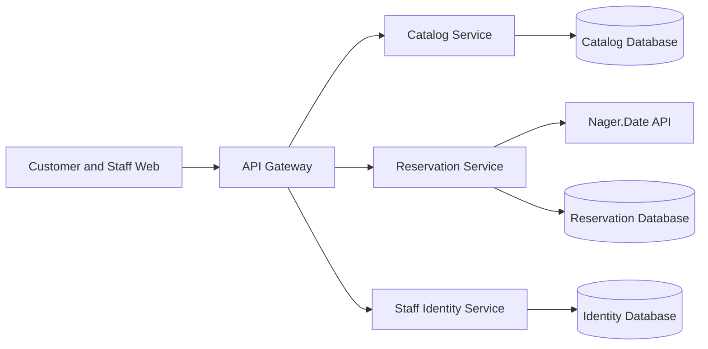

# ออกแบบ Microservices สำหรับ Boardgame & Brew Café

เอกสารนี้เป็นแบบออกแบบตามงานสัปดาห์ที่ 13; ระบบที่ส่งมอบปัจจุบันยังเป็น Express application เดียว ไม่ได้แยก deploy เป็น services จริง

## การแบ่งบริการตาม Bounded Context

| บริการ | ความรับผิดชอบและข้อมูลหลัก | Endpoint หลัก |
| --- | --- | --- |
| Catalog Service | เกม หมวดหมู่ และรีวิว (`boardgames`, `categories`, `reviews`) | `GET /api/v1/boardgames`, `GET /api/v1/boardgames/:id`, `GET/POST /api/v1/categories` |
| Reservation Service | ลูกค้า คำขอจอง สถานะ และเกมที่ผูกกับการจอง (`customers`, `reservations`, `reservation_games`) | `POST /api/v1/reservations`, `GET /api/v1/reservations`, `PATCH /api/v1/reservations/:id/status` |
| Staff Identity Service | บัญชีพนักงานและการพิสูจน์ตัวตน (`staff_users`) | `POST /api/v1/auth/signup`, `POST /api/v1/auth/login`, `POST /api/v1/auth/logout`, `GET /api/v1/auth/me` |

## แผนภาพสถาปัตยกรรมเป้าหมาย

API Gateway เป็นจุดเข้าระบบและตรวจ session/route เท่านั้น ไม่ใช่ bounded-context service; ขอบเขตข้อมูลแยกตามบริการด้านบน ในการย้ายจริงควรแยก schema/database ownership ด้วย และไม่ให้บริการอื่นเขียนตารางข้ามขอบเขตโดยตรง

## รูปแบบการสื่อสาร

| จาก | ไป | รูปแบบ | เหตุผล |
| --- | --- | --- | --- |
| Browser | API Gateway | Synchronous HTTP | หน้าเว็บต้องใช้ผลค้นหา เกม รีวิว และการจองเพื่อแสดงผลทันที |
| API Gateway | Catalog Service | Synchronous HTTP | ต้องคืนรายการเกม/หมวดหมู่หรือผลแก้ไขให้ client ใน request เดียว |
| API Gateway | Reservation Service | Synchronous HTTP | ต้องแจ้งเลขการจองหรือสถานะล่าสุดทันที |
| API Gateway | Staff Identity Service | Synchronous HTTP | login และตรวจ session ต้องรู้ผลก่อนอนุญาตการจัดการ |
| Reservation Service | Nager.Date | Synchronous HTTP แบบมี timeout | ใช้แสดงข้อมูลวันหยุดประกอบการจอง; หากล้มเหลวใช้ fallback และยังบันทึกการจอง |
| Reservation Service | งานแจ้งเตือนร้าน (ส่วนต่อยอด) | Asynchronous event | การแจ้งเตือนไม่ควรเพิ่ม latency หรือทำให้การบันทึกการจองล้มเหลว |

## จุดที่ต้องมี Resilience

| บริการที่เรียก | ปลายทาง | Timeout / Retry / Fallback | เหตุผล |
| --- | --- | --- | --- |
| Reservation Service | Nager.Date | timeout 3 วินาที, retry เฉพาะ network/timeout/5xx สูงสุด 2 ครั้ง, fallback `checked=false` | เป็น API ภายนอกและข้อมูลวันหยุดเป็นข้อมูลเสริมต่อการรับจอง |
| API Gateway | Catalog Service | timeout สั้นตาม SLO, retry เฉพาะ GET และ network/5xx แบบจำกัดครั้ง; แสดง 503 เมื่อยังล้มเหลว | ป้องกัน request ค้างและไม่ retry mutation ที่อาจทำซ้ำ |
| API Gateway | Reservation Service | timeout ตาม SLO; ไม่ retry POST โดยไม่มี idempotency key; ตอบ 503 เมื่อ unavailable | ลดความเสี่ยงสร้างการจองซ้ำ |
| API Gateway | Staff Identity Service | timeout; ไม่ retry login/signup; แจ้งข้อผิดพลาดชัดเจน | ป้องกันการทำงานซ้ำและลด brute-force amplification |

## สถานะเทียบกับ implementation

ปัจจุบัน `src/app.js` รวม routes ของ catalog/reservation/auth ใน process เดียวและใช้ฐานข้อมูล `boardgame_db`; มีเพียง Nager.Date ที่เป็นบริการภายนอกจริง ระบบยังไม่มี API Gateway, service-to-service calls หรือ database แยกต่อ context เอกสารนี้เป็น target design ตามโจทย์ ไม่ควรอธิบายว่าระบบปัจจุบันแยก microservices แล้ว
